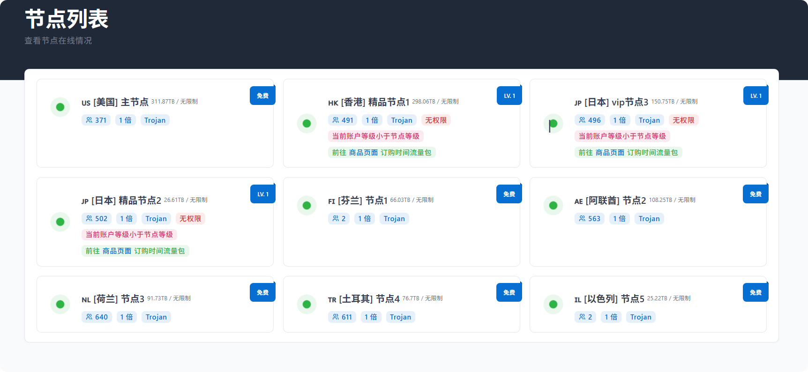
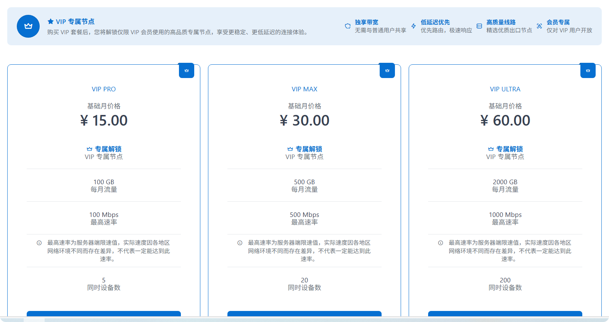
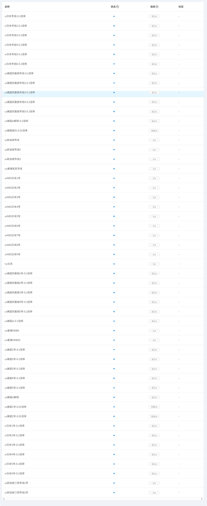
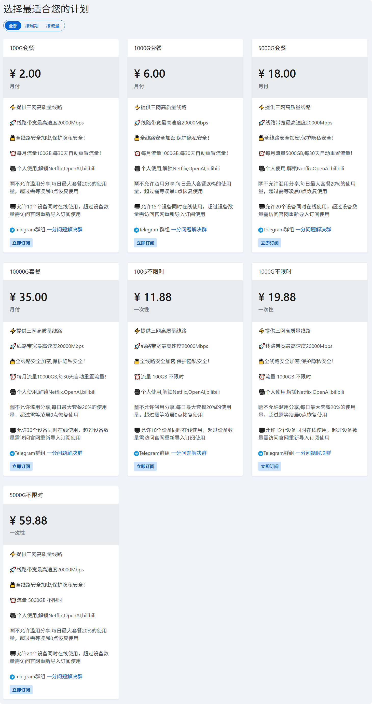
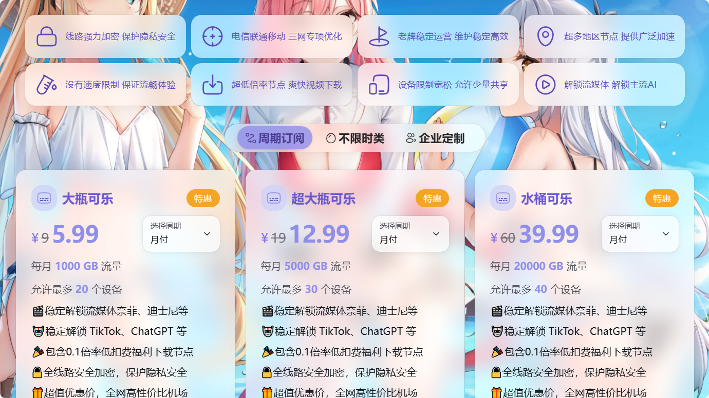
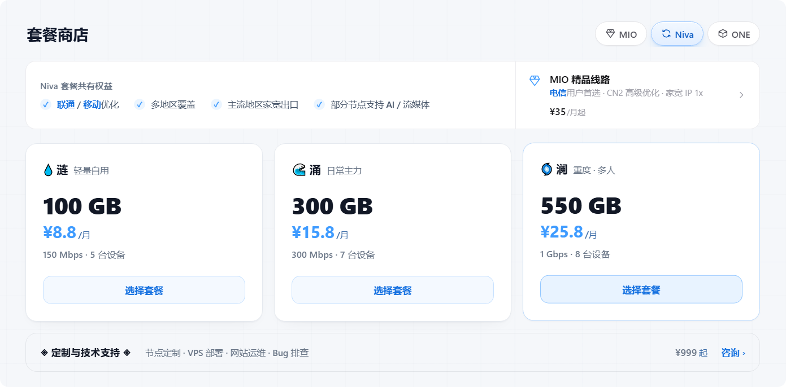
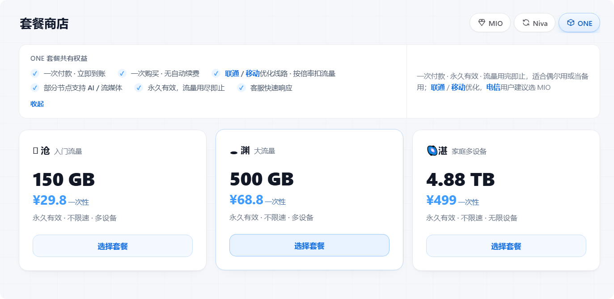

# 魔法上网，实际可用，机场、梯子✈️

> 最后更新：2026-10-31
>
> 本项目用于记录个人使用体验和安全提醒，不提供账号、密码、订阅链接或任何保证。

## 使用前须知

- 请遵守你所在地区的法律法规以及服务提供方的使用条款。
- 不要把个人账号、密码、订阅链接、私钥、付款信息提交到 GitHub。
- 本页面的评价来自个人体验，服务质量、价格和可用性可能随时变化。
- 第三方链接请自行核验域名和隐私政策，不要安装来源不明的软件。

## 痛点

> 想体验使用 GPT、Claude 等，但苦于链路不通，寻找的一些魔法链接无法打开；或者只是想体验一下，发现订阅太贵；又或者你想临时找一些小众节点，但很多机场宣传中有你需要的节点，注册后的体验套餐却没有。以下把可使用的机场记录下来，供参考。

## 使用建议

使用前请准备一些必须的工具，按操作系统选一个就行了，未注明的就是开源免费的。

- Windows：Clash Verge Rev、FlClash、v2rayN
- macOS：Clash Verge Rev、FlClash、ClashX Meta
- Android：NekoBox、FlClash、ClashMeta
- iOS：Shadowrocket（小火箭，收费）、Clash MI

小火箭需要非大陆地区的 Apple ID 登录市场才能安装，并且需要收费。如果找不到已下载过小火箭的 Apple ID，可以使用 Clash MI。

本经验适合轻度使用，或能接受速度不是很快的需求。

## 初次使用（先获得魔法能力）

### Freedoor（每天签到领流量）

- 入口：[Freedoor 机场入口](https://freedoorpmce6z.com/code=a4004cbe27)
- 特点：领取流量不过期，无需魔法能力即可打开获得初步能力。
- 节点：节点清晰列明，免费节点可用到美国、芬兰、阿联酋、荷兰、土耳其、以色列，开通套餐还可使用香港、日本。
- 稳定性：较稳定
- 速度表现：200-300ms
- 个人评价：适合获得初始能力、其他机场到期需充值而打不开网页、使用小众节点。

## 长期使用 低价优选（名字就很明了）

### 一分机场

- 入口：[一分机场](https://xn--4gqx1hgtfdmt.com/#/register?code=bkjhoGMY)
- 备用：[一分机场](https://xn--4gqx1hgtfdmt.com/#/register?code=CHhl60qq)
- 特点：低价，大众节点，本来价格就低，还有流量打折
- 节点：美、日、新、港、台
- 稳定性：较稳定
- 速度表现：各节点有高有低，50-300ms 不等，按需选择
- 个人评价：便宜，日常足够使用

### 赔钱机场

- 入口：[赔钱机场](https://www.xn--mes358aby2apfg.site/register?code=z291v7v0&cover=sfw)
- 特点：低价，大众节点，本来价格就低，还有流量打折
- 节点：美、日、新、港、台
- 稳定性：较稳定
- 速度表现：各节点有高有低，50-300ms 不等，按需选择
- 个人评价：便宜，日常足够使用

## 节点需求（全球各地节点）

### NIVA Network

- 入口：[NIVA Network](https://niva.sh/r/rt3k)
- 备用：[NIVA Network](https://niva.page/r/rt3k)、[NIVA Network](https://nivagate.com/r/rt3k)、[NIVA Network](https://niva.lol/r/rt3k)
- 特点：节点选择多（60+），而且新人注册三天免费 7G
- 节点：遍布全球 64 个节点，包括美国、加拿大、英国、德国、荷兰、乌克兰、冰岛、澳大利亚、香港、日本、新加坡、越南、泰国、马来西亚、菲律宾、阿富汗、印度、伊朗、帕劳、安道尔、安奎拉、尼日利亚、阿鲁巴，还有南美节点
- 稳定性：稳定
- 速度表现：各节点有高有低，50-200ms 不等
- 个人评价：节点提供多，适合临时使用特别节点或需要稳定的场景

> 注意：不要在公开页面粘贴该网站登录后的订阅地址、邀请码、账号或密码。

## 免责声明

以上内容仅用于记录个人使用体验和技术交流。请在遵守所在地法律法规及服务条款的前提下使用。项目发布者不对第三方服务的稳定性、安全性、价格或可用性作任何保证。
